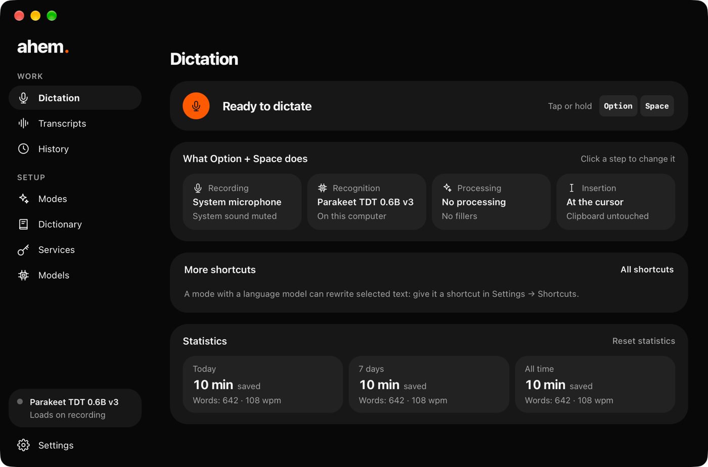
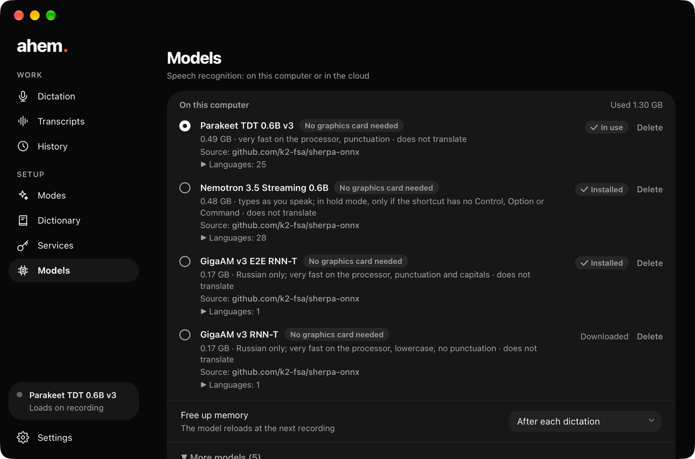
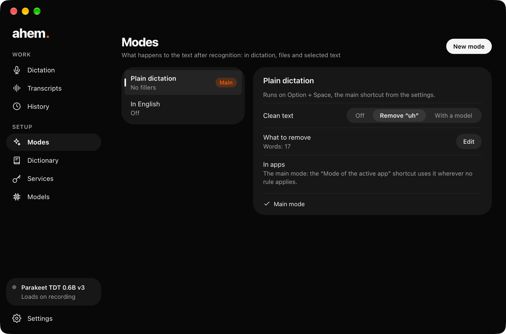
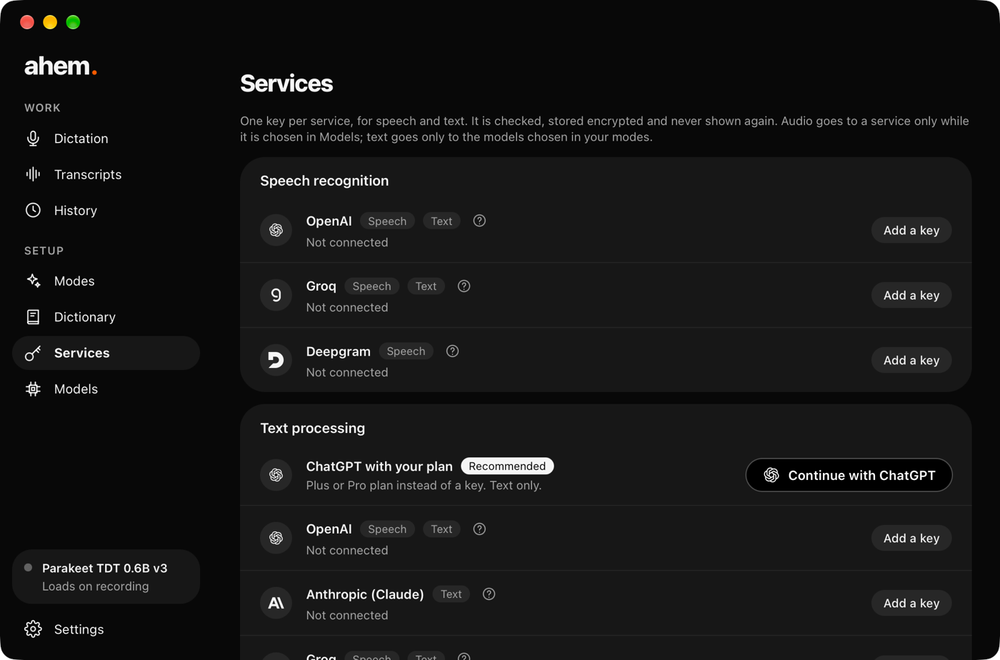
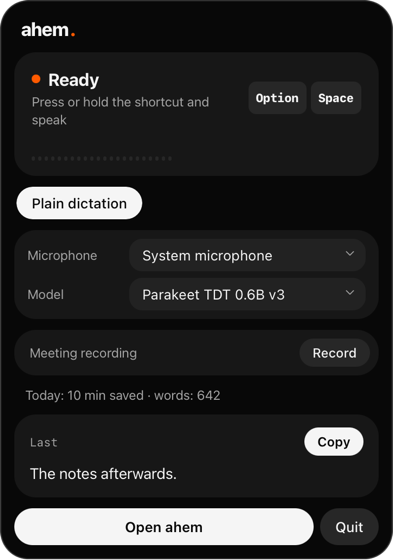

<h1 align="center">ahem<span>.</span></h1>

<p align="center"><b>Dictation that types where your cursor is.</b><br>
Press a hotkey, speak, and the text appears in any app. Local by default, private, no account.</p>

<p align="center">
  <a href="LICENSE"></a>
  
  <a href="https://useahem.app"></a>
</p>

<p align="center"></p>

Speech is recognized **on your computer** by default; a cloud service is used only if you choose one. Optional processing with a language model uses your own API key. There is no account, no telemetry and nothing locked behind a payment.

[Website](https://useahem.app) · [Releases](../../releases) · [Issues](../../issues) · [Security](SECURITY.md)

## Install

Download the installer for your system from the [Releases](../../releases) page (or from the website).

**macOS (Apple Silicon).** Open the `.dmg` and drag ahem to Applications. The app is signed with its own certificate, not notarized by Apple, so the first launch needs one extra step: open ahem, and when macOS says it cannot verify the app, go to **System Settings → Privacy & Security**, scroll down and press **Open Anyway**. You do this once. Then allow the **Microphone**, and **Accessibility** (to type the text into other apps).

**Windows.** Run the installer. The first builds are not signed, so SmartScreen may warn: press **More info → Run anyway**.

Then open **Models**, download a speech model and press the hotkey (Option + Space on macOS, Ctrl + Alt + Space on Windows by default).

## Features

- **Dictation** into any text field: hold the hotkey while you speak, or press it once to start and again to stop. A small indicator shows recording and recognition without taking the focus.
- **Local recognition** with three engines: [whisper.cpp](https://github.com/ggml-org/whisper.cpp) (Whisper Large v3, Turbo, Medium; GPU through Vulkan on Windows and Metal on macOS), [sherpa-onnx](https://github.com/k2-fsa/sherpa-onnx) on the processor (Parakeet, Nemotron with text typed as you speak, GigaAM for Russian) and [llama.cpp](https://github.com/ggml-org/llama.cpp) (Qwen3-ASR). Models are downloaded in the app from their official sources and checked by SHA-256.
- **Cloud recognition**, if you choose it: Groq, OpenAI or Deepgram with your key.
- **Modes**: send the dictated text to a language model (OpenAI, Anthropic, Groq, DeepSeek or your own OpenAI-compatible server) with your instruction, each mode on its own hotkey.
- **Use your ChatGPT plan**: with ChatGPT Plus or Pro, modes can run on your plan instead of an API key — “Continue with ChatGPT” in Services.
- **Rewrite selected text** in any app by hotkey with a mode.
- **Files**: transcribe audio and video to TXT, Markdown, SRT, VTT or JSON with word times.
- **Meetings**: record a call from your microphone and the computer's sound — no bot joins the call — then transcribe it with the voices told apart. Meetings and transcribed files are kept in Transcripts until you delete them.
- Updates: the app tells when a new version is out and installs it in one press; a package is installed only if it carries the project's signature.
- History, tray, start at login, mute while recording, a dictionary of your terms, interface in English and Russian.

API keys are stored encrypted: with DPAPI on Windows, with a key from the login Keychain on macOS.

### More screenshots

<p align="center">
  
  
</p>
<p align="center">
  
  
</p>

## What leaves your computer

Nothing, unless you choose a service: there is no telemetry. The one thing the app does by itself is to ask GitHub for the file with the newest version about twice a day (GitHub sees the request, as any website does, and the app's name and version); it sends nothing about you or your dictations. With a service chosen, it gets:

- **A cloud recognition engine**: the audio of your dictations, of the files you transcribe and of both tracks of a meeting — the other participants' voices too — and your dictionary terms.
- **A mode with a language model**: the recognized text and, if you tick them, the selected text, the clipboard and the name of the program in focus.
- **Rewriting the selected text**: the selected text.
- **ChatGPT sign-in**: OpenAI gets an identifier of this installation.

Downloads of models and engines come from their official sources.

## License and credits

ahem is free software under the [GPL-3.0-only](LICENSE), © 2026 ousttx. It uses the work of others, named in [THIRD_PARTY.md](THIRD_PARTY.md) with their licenses and the credit some of them ask for. OpenAI, ChatGPT, Whisper, Anthropic, Groq, Deepgram, DeepSeek, NVIDIA and the other names there belong to their owners; ahem is not affiliated with, endorsed by or sponsored by any of them.

If ahem helps you, you can say thanks on the website: [useahem.app/#donate](https://useahem.app/#donate). Nothing is locked behind it.

## Contributing

See [CONTRIBUTING.md](CONTRIBUTING.md).

## Development

Requirements: Node.js (LTS), CMake, Rust (stable; MSVC toolchain on Windows) and the [Tauri prerequisites](https://v2.tauri.app/start/prerequisites/) for your OS.

```sh
npm install
npm test          # frontend unit tests
npm run build     # type-check and build the frontend
npm run tauri dev # run the app
cargo test --manifest-path src-tauri/Cargo.toml  # Rust tests
cargo clippy --manifest-path src-tauri/Cargo.toml --all-targets  # Rust lints
```

Before the first Rust build fetch the prebuilt sherpa-onnx libraries the build links. The speech engines run as separate programs from `runtimes/`: llama.cpp is the official build; whisper.cpp (`whisper-server`) is built from the pinned official source, with Vulkan on Windows and Metal on macOS. Every script checks pinned SHA-256s.

| | Windows (PowerShell) | macOS |
|---|---|---|
| sherpa-onnx | `tools\fetch-sherpa-onnx.ps1` | `tools/fetch-sherpa-onnx.sh` |
| llama.cpp | `tools\fetch-llama-cpp.ps1` | `tools/fetch-llama-cpp.sh` |
| whisper.cpp | `tools\build-engine.ps1` | `tools/build-engine.sh` |

On Windows run a script with `powershell -NoProfile -ExecutionPolicy Bypass -File <script>`; building whisper.cpp needs the Visual Studio Build Tools and the Vulkan SDK (or `-NoVulkan` for the processor only).

On macOS, typing and reading the selected text need the Accessibility permission, recording needs the microphone permission, and recording a meeting's computer sound needs the permission to record system audio.

Architecture: [docs/ARCHITECTURE.md](docs/ARCHITECTURE.md). Dependencies and licenses: [docs/DEPENDENCIES.md](docs/DEPENDENCIES.md).
